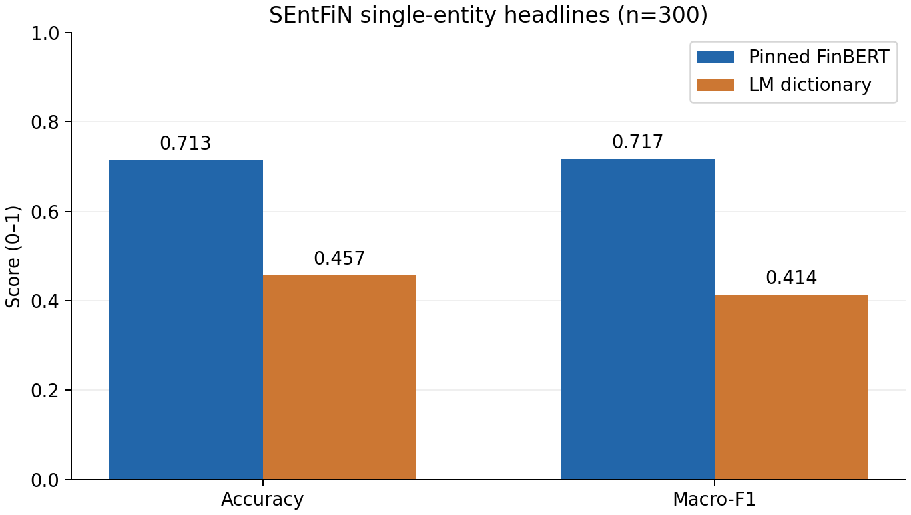
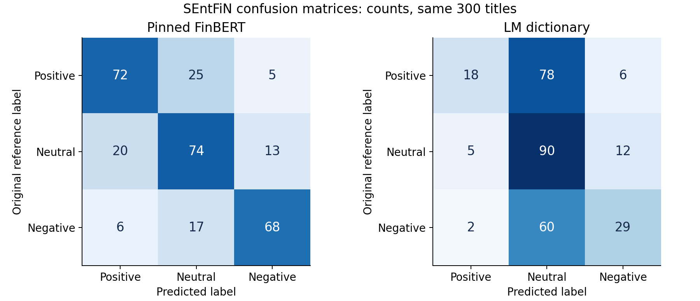

# SEntFiN paired sentiment evaluation — actual results

Run **5 November 2026 Australia/Sydney**, isolated from production. This is a
**single-annotated-entity English headline benchmark**, not an evaluation of news
collection, source attribution, industry classification or the complete product.
The user explicitly authorized this run, replacing the earlier 60-item/double-review
packet requirement. That earlier partial packet remains historical, unused here.

## Observed results

Both methods received the same 300 normalized titles, with identical recorded input
SHA-256 values. Original reference labels: **102 Positive, 107 Neutral, 91 Negative**.
Actual pinned FinBERT CPU inference completed **300 calls**; no mock backend or LLM
reference generation was used. Neither model nor lexicon rules were tuned.

| Method | Correct / 300 | Accuracy | Macro-F1 | Output coverage | Failures |
|---|---:|---:|---:|---:|---:|
| Pinned FinBERT | 214 | 71.33% | 0.717346 | 100% | 0 |
| LM 1993–2025 dictionary | 137 | 45.67% | 0.413689 | 100% | 0 |

FinBERT's observed accuracy difference is **25.67 percentage points**, and macro-F1
difference **0.303657**. These are descriptive results on one fixed sample, not a
statistical significance or generalization claim. Post-sampling input-limit
exclusions: **0**. Both primary metric denominators are the same 300 records.

The dictionary matched at least one active sentiment word in **77/300 (25.67%)**
titles; **223/300 (74.33%)** had no matches. The fixed rule assigns no-match/tie
inputs Neutral. This is why 100% output coverage must not be interpreted as 100%
lexical evidence coverage. Predicted counts (Positive / Neutral / Negative):
FinBERT **98 / 116 / 86**; dictionary **25 / 228 / 47**.



| Method | Reference class | Support | Precision | Recall | F1 |
|---|---|---:|---:|---:|---:|
| FinBERT | Positive | 102 | 0.734694 | 0.705882 | 0.720000 |
| FinBERT | Neutral | 107 | 0.637931 | 0.691589 | 0.663677 |
| FinBERT | Negative | 91 | 0.790698 | 0.747253 | 0.768362 |
| LM | Positive | 102 | 0.720000 | 0.176471 | 0.283465 |
| LM | Neutral | 107 | 0.394737 | 0.841121 | 0.537313 |
| LM | Negative | 91 | 0.617021 | 0.318681 | 0.420290 |

Confusion matrices below use **rows = original reference**, **columns = prediction**.

| FinBERT | Positive | Neutral | Negative |
|---|---:|---:|---:|
| Positive | 72 | 25 | 5 |
| Neutral | 20 | 74 | 13 |
| Negative | 6 | 17 | 68 |

| LM dictionary | Positive | Neutral | Negative |
|---|---:|---:|---:|
| Positive | 18 | 78 | 6 |
| Neutral | 5 | 90 | 12 |
| Negative | 2 | 60 | 29 |



## Data, selection and original labels

Source: [pyRis/SEntFiN](https://github.com/pyRis/SEntFiN), **SEntFiN 1.0**, commit
`eba43610fe3cb57a3e5773cd6c037da1f8992ad5`. Downloaded the actual `SEntFiN.csv`,
`LICENSE` and `README.md` from that commit. The CSV contains **10,753 rows** with
`S No.`, `Title`, `Decisions` (entity-to-label dictionary text), and `Words` columns.
Reference labels come from the dataset authors' human annotation, **not this team's
independent double annotation**. Original label strings were preserved.

The repository supplies an [MIT licence](https://github.com/pyRis/SEntFiN/blob/eba43610fe3cb57a3e5773cd6c037da1f8992ad5/LICENSE),
copyright 2021 Ankur Sinha, Satishwar Kedas, Rishu Kumar and Pekka Malo. The licence
copy stays beside the downloaded data. This run uses that distributed academic
dataset in local isolation; raw titles and row-level predictions are not republished
in Git. Repository licensing is not asserted as blanket permission for unrelated
publisher collection or redistribution.

Selection was fixed **before inference** at 2026-11-04 14:01:30 UTC / 5 November
01:01:30 Sydney. Safe literal parsing, exactly one annotated entity, original label
in Positive/Neutral/Negative (stored lowercase), nonempty normalized title, and Latin
script screen. English status relies on the published English corpus plus the script
screen, not an independent language annotation. No keyword, company, sentiment
balancing, model score or performance filter was applied.

| Selection stage | Rows |
|---|---:|
| Raw CSV | 10,753 |
| Excluded: parseable multi-/non-single-entity | 2,834 |
| Excluded: malformed annotation dictionary | 13 |
| Removed concordant duplicate rows | 44 |
| Excluded all rows in conflicting duplicate-label groups | 16 |
| Eligible unique titles | 7,846 |
| Fixed random sample, seed 20261105 | 300 |
| Eligible but not sampled | 7,546 |

The 13 malformed dictionaries contain unescaped apostrophes in entity names;
inspection showed multiple entities. They were logged as parse failures, not repaired
or silently reclassified. Together with 2,834 parseable multi-entity rows, this
reconciles to the paper's 2,847 multi-entity headlines. Duplicate key is casefolded
NFC/whitespace-normalized text. All conflicting-label rows are excluded; earliest
source row retained for concordant duplicates. No human adjudication was invented.

## Methods, versions and reproducibility

Preprocessing: existing `paired_sentiment_evaluation.preprocess`, NFC Unicode and
whitespace normalization only, original title only; no summary, translation, HTML
fetch or truncation. This differs from product NFKC/HTML cleaning, body preference,
language heuristics and 1,400-character lead span. The experiment deliberately tests
title sentiment rather than the product preprocessing/selection chain.

FinBERT: `ProsusAI/finbert` revision
`0bc2ac10dda6929bcb1f77ccc43c7ec5c424f031`, existing hash-verified local weights,
CC BY-NC-SA 4.0 weight licence recorded by the pinned manifest. CPU eval/inference
mode, one title per call, tokenizer limit 512 including special tokens, no truncation.
Highest-probability class, fixed tie order positive/neutral/negative. No fine-tuning,
threshold tuning, new model downloads or external inference calls.

Dictionary: **Loughran-McDonald_MasterDictionary_1993-2025.csv** from the
[official authors' site](https://sraf.nd.edu/loughranmcdonald-master-dictionary/),
free academic research scope as recorded on acquisition. 86,553 entries; 347 active
positive and 2,345 active negative entries. Include category flags >0, count
case-insensitive alphabetic token occurrences; no stemming, negation or intensifier
rules. Positive when P>N, Negative when N>P, otherwise Neutral. Dictionary file is
not redistributed. No-match results are disclosed above.

| Artifact | SHA-256 |
|---|---|
| SEntFiN CSV | `570af7ba58f724f3fcc414dd5ba80da5b1a3b342134d76c6ebdf53a32c54a92f` |
| LM CSV | `e2d1328682bab7d2187684fb9f5420bb730401c9eefc00daf835edd203f4859d` |
| Locked sample JSON | `25cc0c3870c6935865d69eba9b06306a5de6a026f03dede7aaf45bdb6af64e90` |

Exact model files, runner/rule hashes and pre-run base Git SHA are recorded in
[protocol.json](evidence/sentfin_20261105/protocol.json). Runtime: Python 3.12.3,
torch 2.14.1+cpu, transformers 5.20.2, huggingface-hub 2.3.0,
safetensors 0.8.0, tokenizers 0.23.3. Figure renderer: matplotlib 3.10.6 in the
existing separate Anaconda environment, not the inference runtime.

Private local directory: `reports/sentfin_20261105/` contains original CSV/licence,
`source.json`, `sample.json`, selection exclusions, protocol, `outcomes.jsonl`,
`predictions.csv`, `metrics.json`, `console.log`, resource/event `run.jsonl`, runtime
versions and independent verification. Public [metrics.json](evidence/sentfin_20261105/metrics.json)
contains aggregates only. Corpus/predictions never enter production SQLite.

Reproduce with the existing pinned AI environment and the exact source CSV above
placed in a **new isolated directory**. Download the exact pinned CSV/licence from
the commit-linked source; use the already obtained hash-matching dictionary. Do not
reuse or overwrite the completed experiment directory for a new experiment.

```powershell
.venv-ai/Scripts/python.exe -m finscope.sentfin_evaluation prepare --directory reports/sentfin_reproduction
.venv-ai/Scripts/python.exe -m finscope.sentfin_evaluation run --directory reports/sentfin_reproduction --lexicon reports/annotation_package_20261105/lexicon/Loughran-McDonald_MasterDictionary_1993-2025.csv --authorized-real-run
# Recompute metrics only, without inference:
.venv-ai/Scripts/python.exe -m finscope.sentfin_evaluation summarize --directory reports/sentfin_20261105
# Use an existing matplotlib environment for aggregate figures:
python -m finscope.sentfin_figures reports/sentfin_20261105/metrics.json docs/assets/sentfin_20261105
```

Runner fixes the sample/protocol before prediction and refuses changed input/code
hashes on resume. Each outcome is checkpointed; recorded IDs are not inferred again.
Failure is recorded and stops the current process; unrun samples remain explicit
missing predictions. No replacement Neutral, automatic retry or resampling.

## Execution and error observations

Unchanged resource gates: 5 GiB available RAM before cold FinBERT stage, 2 GiB while
running. **0 resource pauses, 0 manual interventions** in this run. The task-owned
FinBERT process completed 300 calls and **exit_verified=true**. Measured stage time
was **23.797 s**, after tokenizer/coordinator preparation; this is not total startup
time or a controlled benchmark against earlier 41/15-second cache observations.
Available system RAM before/after the stage: **14.46 / 14.38 GiB**, minimum sampled
**13.61 GiB**. These are system observations, not leak proof. Recorded child PID
Working Set can refer to the Windows venv launcher, not the full model descendant;
do not use it as a complete model-memory peak. No user LM Studio model was touched.

Independent Counter-based recomputation from saved predictions reproduced both
accuracies and macro-F1 values. FinBERT made **86** reference disagreements; LM made
**163**. The most frequent FinBERT direction was Positive→Neutral (25), followed by
Neutral→Positive (20). LM mapped 78 positive and 60 negative references to Neutral.

Engineering spot-check of the **first six FinBERT disagreements in fixed sample
order**, not selected to favour either method, used IDs 4128, 1641, 10000, 7222, 8085,
6602. Examples without republishing headlines: an expected share-price upside (1641)
was Positive in the reference but Neutral for both methods; a delisting-related
price rise (7222) was Positive in the reference, Neutral for FinBERT and Negative for
LM; regulatory scrutiny (6602) was Neutral in the reference but Negative for FinBERT.
These are actual output disagreements, not corrected labels or a new human study.
Possible task/wording mismatches are interpretations, not established causal errors.

## English Results paragraph — technical material for the report team

On a fixed random sample of 300 deduplicated single-entity English headlines from
SEntFiN 1.0, the pinned FinBERT model achieved 71.33% accuracy and a macro-F1 of
0.7173, compared with 45.67% accuracy and a macro-F1 of 0.4137 for the fixed
Loughran–McDonald dictionary baseline. Both methods processed the same normalized
titles and completed all 300 cases without inference failures or post-sampling
input-limit exclusions. Reference labels comprised 102 positive, 107 neutral and
91 negative cases. The dictionary matched sentiment vocabulary in only 77 titles
(25.67%); its predefined no-match rule therefore contributed to a predominance of
neutral predictions. Labels were supplied by the dataset's original annotators,
not newly collected from our team.

## English Limitations paragraph — technical material for the report team

This experiment measures agreement with existing entity-level annotations on a
single-source, single-entity headline benchmark. It does not validate article-level
summaries, multi-entity sentiment, industry classification, live news ingestion or
the complete FinScope pipeline. FinBERT predicts sentence-level tone without an
explicit entity target, whereas SEntFiN references are entity-specific. English
eligibility relied on dataset provenance and a script screen rather than new human
language annotation. The sample and rules were fixed before inference, but no
confidence intervals or significance tests were performed, and overlap with model
pretraining or fine-tuning corpora was not independently ruled out. The dictionary
baseline has limited headline vocabulary coverage and no negation handling; the
observed difference therefore applies to these fixed methods and this sample.
Product preprocessing also differs from the experiment's title-only normalization.

## Citation

Sinha, A., Kedas, S., Kumar, R., & Malo, P. (2022). *SEntFiN 1.0: Entity-aware
sentiment analysis for financial news*. Journal of the Association for Information
Science and Technology, 73(9), 1314–1335. [doi:10.1002/asi.24634](https://doi.org/10.1002/asi.24634).
Dataset authors and scope are corroborated by the
[IIM Ahmedabad publication record](https://www.iima.ac.in/publication/sentfin-10-entity-aware-sentiment-analysis-financial-news).
This technical evidence does not claim independent team annotation, user testing,
coursework submission, or replacement of the frozen historical evaluation.
