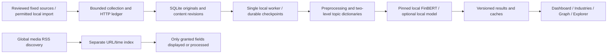

# FinScope — technical reference for the report team

Evidence checked **4 November 2026 Australia/Sydney**; the 2 November handoff below remains a separate sealed historical baseline. The three members write the academic report independently. This reference supplies verified technical facts and evidence, not a submission manuscript, claimed human participation or an academic interpretation.

## Milestone and baseline

**5 November annotation preparation (not evaluation):** a new private partial
package contains three previously unused RBA title-only inputs and blank A/B and
adjudication workbooks; 57 texts are missing against the proposed 60. Actual LM
1993–2025 dictionary version/hash and isolated paired scoring utilities are ready.
No predictions or human labels exist for this packet. See
[dated package evidence and limitations](ANNOTATION_PACKAGE_20261105.md). Step 3
clean-environment acceptance and step 4 sampling/reference lock/formal run remain
unfinished; earlier plan-only statements below describe their historical dates.

**2 November 2026 18:00 Australia/Sydney** is the internal report handoff; technical readiness is due before noon. It is not the official submission deadline or a permanent feature freeze. Development continues on `local`; `main` is read only. A separate final feature freeze and full regression will precede actual submission. The historical official-deadline conflict remains unresolved; the user handles it without further agent Moodle access.

The accepted runtime/data baseline is **`97f0529f32bcbec012368fe1138b4187d3d7d8ae`**, with [all three exact-SHA CI jobs successful](https://github.com/DVDWK812/Finscope/actions/runs/41284045331). The dated [handoff record](REPORT_HANDOFF_20261102.md) identifies the package, screenshots, local snapshot and final delivery receipt. Later development must use separate evidence directories/commits. The consumed evaluation and all 171 protected files remain frozen; historical [delivery-freeze evidence](DELIVERY_FREEZE.md) is preserved byte-for-byte, not a current permanent product-development restriction.

## Delivery closeout — 4 November 2026 Sydney

The local product is now in delivery closeout, with no new feature work. The sealed
2 November runtime baseline and its 266 originals / 232 historical analyses are
unchanged. Later private-media observations must not be attributed to that baseline.

At **2026-11-04 02:01 Sydney / 2026-11-03 15:01 UTC**, a read-only check of the live
finite SQLite partition found **84 unexpired media originals**: Finnhub 30 and
Marketaux 54 (52 Broad plus two earlier company-query records). **81** contain actual
nonempty supplier summaries. Latest topic results are **39 classified, 37 unclassified,
8 failed**; **80** distinct records have actual FinBERT results and **4** remain language
skips. Those 80 results comprise 23 Positive, 35 Neutral and 22 Negative, not accuracy
labels. No expired/inactive media records were included. Existing expiries span
**8 November 17:36 UTC–9 November 17:52 UTC**; these are a dated observation, not a
promise that the same corpus remains available at presentation time. Current overall
storage is 350 originals including five authored development records, not 350 real
media articles. Original publisher attribution and private-research applicability
qualifications continue to apply; no text or per-article outputs are supplied here.

The subsequent Stage A collection had reached Broad 52 before this closeout. This
closeout made no news HTTP requests and reran no successful real-news analysis.
A reproducible scheduler defect was fixed: a generic classification exception put
an original in a rejected set and skipped its independent sentiment stage. Sentiment
now still checks permissions, text eligibility, language, resources and model cache.
Classification failure remains recorded; it is not converted into a topic label.

Actual authored-input validation on 4 November completed three MiniLM/FinBERT process
cycles, each with verified exit code 0. MiniLM reused its process within each cycle.
System available RAM at cycle start/end was 5.88/5.75, 5.75/5.35 and 5.33/5.35 GiB;
this does not establish a leak-free system. An isolated authored two-record Update &
Analyze run preserved a deliberately injected pre-dispatch pause, resumed to two real
FinBERT results (including one classification-error record), reopened both saved
originals and reused results on a second task with zero additional sentiment inference.
The pause/failure injection is engineering validation, not naturally observed model
failure or real-media acceptance. At that check Gemma was not loaded: its local
preflight required 7.19 GiB RAM while 5.05 GiB was available. A subsequent authorized
attempt also stopped before load at 6.33 / 7.17 GiB available / required RAM.

**Later user-requested Gemma retry, 4 November Sydney: basic inference and unload
passed.** Installed `google/gemma-4-e4b` Q4_K_M loaded with context 2048 and GPU ratio
0.8 under the unchanged resource guard. One authored fictional-bank input returned
Banking/Finance and positive business conditions in **0.92 seconds**, with
`finish_reason=stop`, 58 input / 31 output tokens. Available RAM before load / resident /
after unload was **8.21 / 3.95 / 9.11 GiB**; available dedicated GPU memory was
**14.96 / 11.30 / 14.96 GiB**. The loopback unload API completed and the subsequent
inventory confirmed the task-created model unloaded; the LM Studio service remained
running. These are system snapshots, not process-level leak evidence. This validates
one basic real inference and cleanup, **not** the full MiniLM/Gemma classification
pipeline, structured taxonomy validation, classification accuracy or sustained
stability. No news was fetched, successful news reanalyzed, database results written,
model downloaded, or protection threshold changed. Evidence is the actual local
load/inference/unload tool output recorded in this chat; the earlier preflight JSON
remains unchanged and does not contain this later success.

Evidence: local ignored `reports/p0_closeout_20261104/live_aggregates.json`,
`reports/p0_20261104_models.json`, `reports/p0_closeout_20261104/result.json` and
`reports/p0_closeout_20261104/gemma_preflight.json`. These remain local technical
receipts; the report team should use only appropriate aggregates and licensed demo
material. Historical media success does not grant publisher redistribution rights.

## First-install engineering supplement — 4 November 2026 Sydney

A narrow local installation exception adds Windows x64 first-install and daily-start
entry points, explicit pinned base-model preparation in Settings, and an optional
memory-only LM Studio authored self-check. It does not alter the hosted showcase,
classification semantics, FinBERT weights or the sealed report/evaluation baseline.

Current-machine evidence (Windows x64, Python 3.12.3): verified existing FinBERT and
MiniLM files reused with zero download calls in **0.636 s**; a real venv was created
and invoked under a Chinese/space path; isolated Streamlit startup reached health
200 in **1.289 s**, returned HTML 200 and its owned process exited. Missing-Python
selection displayed official guidance. A deliberately occupied local port stopped
the launcher before Worker creation and preserved the occupying listener.

Two **new authored** records in isolated SQLite completed dictionary classification
and actual pinned FinBERT, with no news requests. Cold batch wall time **66.433 s**;
individual inference timers **13,104.49 / 2,691.01 ms**; backend released. A second
saved-input task took **41.174 s**, with zero additional classifications/inferences;
reopening retained two originals/two analyses. Cache wall time includes resource and
queue checks, not just lookup, and the OS file cache was not cleared. Concurrent
regression work may affect these one-run timings; they are not throughput benchmarks.
Evidence: ignored `reports/first_install_20261104/{result.json,server.json}`.

Offline suite: **714 tests passed, one skip**; dry run passed. Download interruption,
corruption, cancellation, mutual exclusion, double-click and installation failures
are mocked tests, not a real first download. Clean Windows without Python, full fresh
package installation and first real weights transfer are **pending**. Existing model
files were never deleted for testing. The [new baseline plan and blank annotation
form](BASELINE_PLAN_20261104.md) remain unrun and contain no human labels. Existing
frozen accuracy figures must not be attributed to these installation smoke tests.

## Installation follow-up status — 4 November 2026 Sydney

**Step 3: code substantially implemented; clean-environment acceptance incomplete.**
Clean Windows, a fully fresh dependency install and a first real weights download
remain pending. **Step 4: plan only; no formal evaluation or human labels.** Its
primary paired comparison is now pinned FinBERT versus a fixed financial sentiment
lexicon on the same new inputs. Optional industry classification evaluation is
separate. Historical installation and frozen challenge evidence are unchanged.

LM Studio discovery now shares one read-only background inventory per server-process
startup across UI reruns/sessions; manual refresh remains explicit. Detection failure
is nonblocking and old successful metadata is marked stale. Native loaded-instance
metadata, rather than compatible API visibility alone, defines loaded status. The
user separately requested using FinScope's existing explicit service-start facility;
that facility was exercised once after the initial connection-refused observation.
Automatic discovery itself never starts services or loads/unloads models.

Actual local metadata identified **qwen/qwen3-1.7b**, variant
**qwen/qwen3-1.7b@q6_k**, GGUF / Q6_K, **1,673,185,778 bytes**, unloaded and not
callable. Actual isolated FinScope browser verification found it without Refresh,
then restarted the owned server and found it again. The stored Gemma selection
remained unchanged. Detection timestamps were 11:59:25.910326 UTC before restart
and 12:00:54.485234 UTC after restart; a second session reused the latter timestamp.
Explicit manual refresh advanced it to 12:03:10.250585 UTC. All models remained
unloaded and this acceptance performed zero inference. This is discovery evidence,
not Qwen inference compatibility, accuracy or full classifier acceptance.

The earlier **41.174 s** cached batch is preserved as its original unsplit measurement.
A new cache-only attempt on the same isolated authored records measured **15.082442 s**
execution plus **0.014512 s** created-to-dispatch waiting. Exclusive execution buckets:
process/GPU observations **11.121725 s**, resource measurements **3.640361 s**, model
state **0.128806 s**, cache lookups **0.012764 s**, instrumented database/storage
**0.086457 s**, other work **0.092329 s**. Cache and database buckets do not double
count nested calls; uninstrumented database/queue overhead remains within other.
The cache attempt performed no new classification or inference and retained two
analyses. It did not invoke inference resource guards; normal stage observations
remained. These single-run timings do not establish an optimization or retrospectively
explain every millisecond of the old batch. Production news/results were not replayed.

Local ignored evidence: `reports/discovery_20261104/service_and_inventory.json`,
`browser_acceptance.json`, `cached_timing.json`. Tests use fake inventory transports
for concurrent startup, failures/stale state and API-visible-but-unloaded cases;
actual browser evidence uses the existing machine, not a clean Windows installation.

## Purpose and architecture

**P3-E engineering, 2 November:** Broad Financial News now separates Marketaux
retrieval from company/industry selection, with optional publisher filtering and
independent fixed-window pagination checkpoints. Finite originals are saved before
the existing local classifier and FinBERT stages. This is an implementation change;
no broad-feed HTTP request or new media inference is claimed until a fresh explicit
UTC-day account budget is provided. The prior private acceptance and sealed handoff
remain separate evidence, with unchanged expiry and redistribution qualifications.

**P3-E later live collection:** An explicitly confirmed immediate private-research
batch added 28 distinct title records with 26 returned descriptions across 11
supplied link domains. Eleven HTTP-200 responses contained 33 observations; five
were duplicates. A wholly repeated page stopped collection before the budget cap.
This verifies broader real acquisition below the 50-record target, not original
authorship, completeness or redistribution permission. Local model outputs and
their completion status remain separate private evidence, not public report text.

**P3-D live continuation, 2 November:** A separately authorized, bounded Marketaux
batch added two real finite title/description records, with subsequent actual local
classification and FinBERT completion. Six requests returned HTTP 200; five query
cohorts were empty. The supplied CNBC-domain links establish a new observed source
path, not verified editorial originality or broad multi-industry coverage. The
private research scope remains unresolved as to third-party applicability. Text,
per-article results and operational evidence remain local and are not shared report
or demonstration material. The earlier sealed handoff baseline is unchanged.

**P3-D continuation, 2 November:** The local media workflow now supports grouped
company sampling, bounded per-query incremental checkpoints, URL-based cross-service
deduplication and explicit supplier/link-domain attribution. Company query cohorts
and supplier entity industries remain separate from text-supported news topics.
Current MiniLM/Gemma prompts, existing sentiment results and the frozen evaluation
are unchanged. Real coverage expansion requires a newly confirmed source scope
and UTC account/application budget; implementation or additional URL indices do
not demonstrate broader real-news coverage. Private finite text is not report or
shared-demo material after its expiry, and private research confirmation never
establishes a publisher licence or redistribution rights.

**Post-handoff engineering, 2 November:** The continuing `local` product now has
an explicit source-level choice between licence evidence, private research with
unresolved applicability, and concrete restrictions. Finite API/RSS titles and
actual summaries use an expiring SQLite partition and the existing offline
classification/FinBERT queue; this is separate from the sealed handoff snapshot.
Engineering fixtures verify retention/cache/restart/batch behaviour. A subsequent
explicitly confirmed private API batch completed actual local FinBERT; its
content, operational receipt and semantic results remain in ignored finite local
storage. This is private research acceptance, with third-party applicability
unverified; it is not publisher-licensed NLP or permission for group/public demos.
No publisher permission is inferred from user research confirmation.

**P3-C continuation, 2 November:** Classification is now independently selectable
from sentiment: pinned MiniLM taxonomy recall plus an installed local semantic
classifier/support review for finite media. A 30-record development diagnosis
completed with explicit unknown/failure outcomes, versioned caches and evidence
under the original finite expiry. It provides engineering observations, no
independent accuracy estimate; FinBERT and the frozen evaluation were not rerun.
See [dated engineering decisions](DECISIONS.md). The sealed handoff figures below
remain the historical report baseline, separate from private research evidence.

FinScope is a single-user, desktop-hosted financial-news/disclosure inspection tool. It supports permitted local text storage, sentiment, evidence-based industry topics and drill-down to originals. It does not forecast returns, establish causation or verify event identity.

The Windows desktop entry opens localhost:8511 and reuses an existing healthy instance. The launcher starts Streamlit plus one OS-locked worker. Closing the browser does not stop the worker. Durable stage/cache records prevent replay of completed work; unknown network/model outcomes require review rather than speculative retries. Local originals live in ignored `reports/finscope_local.sqlite3`; permitted SEC archive objects have local hash/index references. Credentials stay in ignored `.env` or Windows Credential Manager, not article/job payloads. [Setup](../README.md), [worker/storage acceptance](P3_BATCH_ACCEPTANCE.md).

Default **Update & Analyze** chains collection and analysis. Advanced **Collect and save only** loads no model; **Analyze saved records offline** makes no news requests. Source-level policies record fields, purposes, attribution, exclusions and retention basis; narrower article restrictions win. API/RSS accessibility alone never establishes storage or NLP rights. Optional external LLMs require separate transmission consent; none is used by the default local workflow.

## Data and actual acceptance denominators

The current library has **266 originals: 261 real-source records plus five authored development records**. It has **232 historical analysis versions**, not 232 independently analyzed current real articles. Read-only SQL and the same current-content matching rules as the UI reproduce these figures.

| Real source | Distinct originals | Retained text scope |
|---|---:|---|
| ABS | 80 | Reviewed official titles/date-only metadata; one retained licensed body |
| NIST | 40 | Official supplied titles/summaries; three reviewed bodies |
| RBA | 1 | Previously retained attributed official feed text |
| SEC official press RSS | 20 | Official title/supplied description; no linked pages |
| SEC EDGAR | 120 | Filing metadata from six issuers; seven suitable operating-event excerpts |

Real records comprise **141 official/government announcements and 120 regulatory disclosures**, with **zero saved media-news or company-IR-release originals**. Six SEC issuers each contribute 20 filings: Microsoft, JPMorgan Chase, Caterpillar, Johnson & Johnson, Exxon Mobil and Amazon. This is a bounded convenience watchlist, not representative global-market coverage.

**148 current-content FinBERT results** cover the 141 announcements and seven event excerpts. The other **113 disclosures are not applicable**, not forced Neutral. Long 10-K/10-Q filings are metadata-only; excerpt sentiment never means whole-filing sentiment. P3-A added **219 distinct real records**, using **34 collector GETs**, all HTTP 200; six responses were rejected by client schema/excerpt checks. These historical calls are not new handoff traffic. [Exact source/request/model evidence](P3_BATCH_ACCEPTANCE.md).

Two-level US-BUSINESS-1 topics classify **17/261 real originals**: **six parent and nine child labels**, with **244 Unclassified**. Parents are Technology, Financials, Industrials, Healthcare, Materials and Consumer Staples. This is lexical evidence coverage, not measured classification accuracy; chip “packaging” is a known semantic ambiguity. All **261 remain Unclassified in CSRC** under the current English vocabulary. Issuer SIC is stored separately and is never the sole evidence for a news topic.

## AI methods and reproducible real example

| Component | Actual method / version | Limits |
|---|---|---|
| FinBERT | ProsusAI/finbert, revision `0bc2ac10dda6929bcb1f77ccc43c7ec5c424f031`; local CPU three-class probabilities | Text tone, not correctness probability, investment signal or general accuracy |
| MiniLM | all-MiniLM-L6-v2, revision `1110a243fdf4706b3f48f1d95db1a4f5529b4d41`; attention-mask mean pooling, normalized 384-D vectors | Similarity candidates are unverified; not validated event deduplication |
| Preprocessing | `product-lead-span-2`; normalized text, traceable leading span, character/token bounds, input fingerprint and coverage | No silent whole-document claim or automatic model download |
| Industry topics | `evidence-dictionary-1`; US-BUSINESS-1 **11/56** and CSRC-JRT0020-2024 **19/91** catalogs | Literal matches and catalog parents; not GICS, general NER or issuer-business validation |
| Optional local LLM | LM Studio/Ollama, explicitly selected local installed model | Separate labels/rationale/history; no invented calibrated probabilities or automatic fallback |

No team training/fine-tuning is claimed. Preparation explicitly verifies pinned local model assets; inference does not download weights or enable remote code. FinBERT weights are CC BY-NC-SA 4.0; MiniLM Apache-2.0. These licences do not grant publisher rights. [Model evidence](AI_PROTOTYPE.md).

The retained ABS release **“Australians buying more fruit and fewer vegetables”**, original ID `2e5baa9cdbe2f1f2701cca2109b3fb75`, is the repeatable local drill-down example. It is dated **30 October 2026, date only**, attributed to ABS/Commonwealth of Australia under the reviewed CC BY 4.0 scope. The current body-matching FinBERT result is **Negative**, probabilities positive **0.0776657164**, negative **0.8981406093**, neutral **0.0241936296**; analysis ID `02734e61ed1a4b61b9b4a6351164f083`. It describes title plus **1349/1675 body characters (80.5373%)**, not the entire publication. Topic evidence maps Consumer Staples → Food and beverages, with literal “beverages” offsets 923–932 and 1138–1147.

A later title-only Neutral analysis remains in history. The UI matches model results to the current content fingerprint; the latest timestamp alone does not select the correct result for a different text version. All four historical rows remain. Dashboard heatmap, Industries, Graph and News Explorer reopen the same permitted original and original link without a new fetch/inference. [Original P2 acceptance](ABS_P2_ACCEPTANCE.md), [dated handoff screenshots](REPORT_HANDOFF_20261102.md).

## Mainstream media: discovery is separate from NLP

The separate index holds **136 links**: Bloomberg 18, CNBC 30, WSJ 59, FT 10, Yahoo 19. P3-B.1 added 28 Bloomberg/FT links with three authorized diagnostic GETs. FT's new literal 301 Location `/rss/home/international` led to one reviewed HTTPS FT request; the original incomplete Bloomberg/FT receipts remain.

Two additional authorized Yahoo GETs returned 200, **300.253837 seconds apart**, across a worker restart; each had 18 entries, zero new links and 18 duplicate observations. No ETag/Last-Modified/304 was received; validator/304/429 branches have offline tests, not fabricated live evidence. Yahoo's source scope permits attributed supplied-title/summary display **in RAM only**; no persistent publisher text or NLP grant is recorded. RAM may expire or disappear after exit, and the demo must not re-fetch to restore it.

Bloomberg/CNBC/WSJ/FT text-use scope remains unverified. After new account-budget confirmation, one `domains=reuters.com` Marketaux query at **2026-11-01 07:36:19 UTC** returned **HTTP 200 with zero records**. No retry/key fallback occurred. Query transport is verified; actual Reuters article coverage remains unverified, and the one-request budget is consumed. Marketaux/Finnhub historical HTTP-200 previews establish connection success; their publisher-content NLP remains unauthorized. **Saved mainstream-media publisher text = 0; mainstream-media FinBERT = 0.** NewsData remains manually paused pending actual subscription/multiple-key constraints and explicit resumption consent. These gates do not block the report handoff. [Per-source results and rights](P3_MEDIA_CONTINUOUS_ACCEPTANCE.md), [API evidence](P2_REAL_NEWS_ACCEPTANCE.md).

## Evaluation, engineering checks and conclusions to qualify

The consumed challenge remains unchanged: **12/16 scorable sentiment agreement (75%), macro-F1 0.730159**, two mixed/uncertain exclusions. Selected-pair cosine precision **0.666667** on ten scorable pairs. P02 crosses reporting periods; uncertain/opposed-outcome P07 still groups. Reviewer independence/completion attestations remain unverified. These small provisional references do not estimate general news accuracy or calibration. [Frozen methodology/results](CHALLENGE_EVALUATION.md).

The accepted code baseline passed **631 offline tests (one platform skip)**, isolated benchmark dry run and two Linux plus one Windows CI jobs. Mocks/authored fixtures test software; real source/model/browser evidence is recorded separately. Handoff rehearsal is read-only against retained real records, with zero new provider/model requests. Agent-operated browser checks are engineering acceptance, not three-human usability evidence.

The strongest demonstrated result is a persistent, rights-gated local source → traceable text/model result → visual drill-down workflow. Remaining limitations include a source/sector-skewed corpus, weak English dictionary classification/CSRC coverage, bounded lead excerpts, incomplete mainstream-media processing rights and unverified Reuters article coverage, no real Yahoo validators/304, no 24×7 SLA, and incomplete contract-specific expiry/deletion/backup enforcement. Human usability records, reviewer attestations, contribution signatures and the final academic interpretation remain team-owned and unverified until actually supplied.

After handoff, continue P3-B.1 source coverage, bounded incremental collection, classification quality and usability in separate commits/evidence directories. Arrange the final feature freeze/full regression separately. Do not overwrite this report baseline, alter the 171 frozen files or rerun/tune the consumed evaluation.

## Primary references and evidence navigation

These are reference suggestions, not citations written on the team's behalf; authors should inspect and format their own references. Model/publication facts below retain their earlier verification dates.

- Araci (2019), [FinBERT](https://arxiv.org/abs/1908.10063); Reimers and Gurevych (2019), [Sentence-BERT](https://aclanthology.org/D19-1410/).
- Pinned [FinBERT model card](https://huggingface.co/ProsusAI/finbert/blob/0bc2ac10dda6929bcb1f77ccc43c7ec5c424f031/README.md) and [MiniLM model card](https://huggingface.co/sentence-transformers/all-MiniLM-L6-v2/blob/1110a243fdf4706b3f48f1d95db1a4f5529b4d41/README.md).
- [P3 source policies/official SEC references](P3_BATCH_ACCEPTANCE.md#policies-and-browserverification-evidence), [ABS policy evidence](ABS_P2_ACCEPTANCE.md), [media rights/transport evidence](P3_MEDIA_CONTINUOUS_ACCEPTANCE.md).
- [Handoff record](REPORT_HANDOFF_20261102.md), [6:15 local demo](DEMO_SCRIPT.md), [operator checklist](DEMO_CHECKLIST.md), [development log](DEVELOPMENT_LOG.md), [AI assistance](CONTRIBUTIONS_AND_AI_DISCLOSURE.md).
